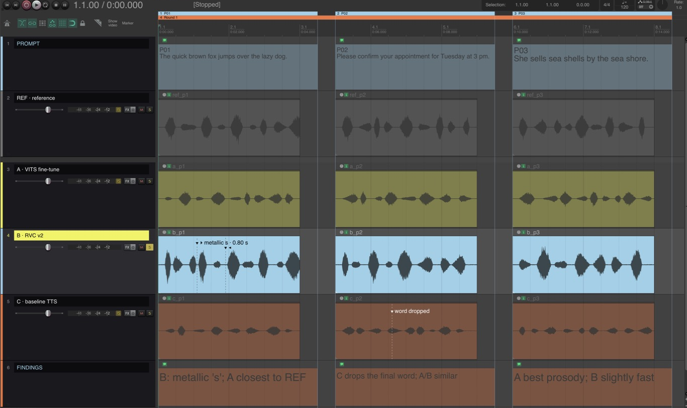
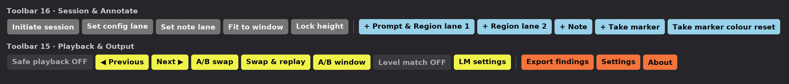

# Inference Review and Presentation Kit for REAPER

A presentation setup for A/B reviews of generated-audio experiments (TTS, RVC and other inference
pipelines) in REAPER: large readable track names, note lanes for prompts and findings, one-key A/B
soloing, and a findings export. Works on macOS and Windows, REAPER 7 (7.62+ for region lanes),
no extensions needed.

Version: see `VERSION` and `CHANGELOG.md`. Press **About** on the toolbar to see which version is installed and whether
the loaded theme matches it.



*A review session made with **Initiate session**: PROMPT (prompt text per region), REF and configs A–C
(**Review** layout: number, large name, fader, meter, M/S), FINDINGS (notes). Prompt regions P01–P03 sit in
ruler lane 1, a "Round 1" region in lane 2. B is playing (name lit), with a duration take marker
(`▸ metallic s · 0.80 s … ◂`); C has a point marker.*



## Install from release (teammates)

1. Go to the repository's **Releases** page and download `inference-review-and-presentation-<version>.zip`.
2. Unzip it. Inside you get:

| File | What it is |
|---|---|
| `Inference_Review_and_Presentation.ReaperThemeZip` | The theme. Based on Cockos Default 7.0 (LGPL), adds two track panel layouts: **Review** and **Review Note**. |
| `Scripts/Inference Review and Presentation/` | 19 Lua scripts, `lib/` and `icons/` (keep the folder together). |
| `README.md`, `CHANGELOG.md`, `VERSION`, `LICENSE.md`, `LICENSE-LGPL-2.1.txt` | This guide, what changed, licences. |

3. Follow **Install (once per computer)** below.

## Install from clone (testers / development)

```
git clone https://github.com/wongchunhoi9/reaper-inference-review.git
cd reaper-inference-review
python3 tools/build.py
```

This writes `dist/inference-review-and-presentation-<version>.zip` (the same zip as a release) and
`dist/Inference_Review_and_Presentation.ReaperThemeZip`. Unzip the kit zip and follow the steps below,
or use the dev bridge (`dev/`, see `CLAUDE.md`) to install straight from the repo.
Needs Python 3 (no extra packages; `tools/make_icons.py` needs Pillow only if you redraw the icons).
To change the version: `python3 tools/set_version.py 1.2.0` (updates `VERSION`, the script library and the theme;
the build stops if they disagree), then add a `CHANGELOG.md` entry.

Repository layout:

| Folder | What it is |
|---|---|
| `theme/src/` | The theme source (WALTER `rtconfig.txt`, images, `.ReaperTheme` colours/fonts). |
| `theme/upstream/` | Untouched Cockos Default 7.0, for comparison. Never edited. |
| `scripts/` | The Lua scripts and `lib/`. Installed as `REAPER/Scripts/Inference Review and Presentation/`. |
| `icons/` | Toolbar button images (100 %, `150/`, `200/`), made by `tools/make_icons.py`. |
| `tools/` | `build.py` (makes the release zip), `set_version.py`, `make_icons.py`. |
| `dev/` | Test bridge into a running REAPER (not shipped). |
| `docs/` | `PLAN.md` (roadmap / checklist). |

## Install (once per computer)

1. **Theme**: double-click `Inference_Review_and_Presentation.ReaperThemeZip` (or drag it onto REAPER).
   It appears in **Options > Themes**. Switch back to your usual theme the same way.
2. **Scripts**: copy the whole `Scripts/Inference Review and Presentation` folder into REAPER's Scripts folder
   (**Options > Show REAPER resource path in explorer/finder**, then `Scripts`).
   In REAPER: **Actions > Show action list > New action > Load ReaScript**,
   select all the `Inference Review and Presentation - ….lua` files (not `lib`), **Open**.
3. **Toolbars**: run **Inference Review and Presentation - Create toolbar file**. It installs the coloured button icons
   and writes two files next to the scripts, using this computer's action IDs:
   `… toolbar 16 (Session, Annotate).ReaperMenu` and `… toolbar 15 (Playback, Output).ReaperMenu`.
   Then **Options > Customize menus/toolbars**: pick **Floating toolbar 16** in the top list,
   **Import/Export > Import**, choose the *toolbar 16* file; pick **Floating toolbar 15**, import the *toolbar 15* file; **OK**.
   (If you already use toolbar 15 or 16 for something else, import into any free floating toolbar instead.)
   Open them from the action list: run **Toolbar: Open/close toolbar 16** and **Toolbar: Open/close toolbar 15**
   and dock 15 under 16 for two tidy rows
   (right-click a toolbar > Dock). REAPER toolbars can't force a line break, which is why the kit uses two.
   **Hover a button** for its tooltip: what it does, what it needs, and the script name.
   Button colours: **grey** = session setup, **blue** = prompts / notes / markers, **yellow** = playback,
   **orange** = export and settings. If the colours look pale, reset
   **Options > Themes > Theme Adjuster / Color Controls** for this theme: its gamma/contrast also tints toolbar icons.
   To turn any other toolbar button into text: right-click it in Customize menus/toolbars >
   **Set tooltip/text icon…**, Mode **Text double-wide icon**.
4. Optional: give the scripts shortcuts in the action list (suggested below).

## Start a review session

1. Switch to the **Inference_Review_and_Presentation** theme.
2. New project, run **Initiate session** (script *Inference Review and Presentation - Initiate session*). Enter the number of
   configs and, optionally, their names separated by `;`.
   You get PROMPT, REF, configs A, B, C … and FINDINGS, coloured, laid out and
   height-locked, with a spacer under REF.
3. Drop the rendered audio for each config on its track.
4. Make a time selection over each prompt's audio and press **+ Prompt & Region lane 1**: it
   creates region P01, P02 … and note items on PROMPT and FINDINGS.
5. Save the project.

## During the presentation

**Turn on Safe playback first**: the button reads *Safe playback OFF* on dark grey and turns solid yellow
*Safe playback ON*. While it is on:

* only **one** of REF / configs is ever audible (exclusive solo in place), so nothing can play all at once;
* **click a config's name** to switch to it instantly; playback keeps running at the same position;
* pressing **S** on another track switches to it; "unsolo all" falls back to the last one instead of opening everything;
* PROMPT / FINDINGS never make sound.

## All toolbar buttons

Script names start with `Inference Review and Presentation - `; search the action list for them to set shortcuts.

| Button | Script | What it does | Needs | Suggested key |
|---|---|---|---|---|
| **Toolbar 16: Session** (grey) | | | | |
| Initiate session | Initiate session | Adds PROMPT, REF, config lanes and FINDINGS, coloured, laid out and height-locked. | an empty project (asks how many configs) | — |
| Set config lane | Set selected tracks as config | Makes tracks config lanes: Review layout with fader, meter, M/S and normal output. | selected track(s) | — |
| Set note lane | Set selected tracks as note | Makes tracks note lanes: name only, no audio output. | selected track(s) | — |
| Fit to window | Fit tracks to window | Resizes all review lanes to fill the arrange view and locks their heights. | nothing (run again after resizing / screen sharing) | `F` |
| Lock height | Toggle height lock on selected tracks | Locks or unlocks the height of the selected tracks. | selected track(s) | — |
| **Toolbar 16: Annotate** (blue) | | | | |
| + Prompt & Region lane 1 | Add prompt | Region P01, P02 … in **ruler lane 1** plus note items on PROMPT and FINDINGS. | time selection (or uses 5 s at the edit cursor) | — |
| + Region lane 2 | Add region lane 2 | Region in **ruler lane 2** for rounds, sections or issues. | time selection; REAPER 7.62+ | — |
| + Note | Add note item | Note item on the selected track, then opens its notes window. | selected track; time selection (or 5 s at the edit cursor) | `N` |
| + Take marker | Add take marker | No time selection: point marker at the edit cursor. With a time selection: duration pair, `▸ text · 1.25 s` at the start and `◂` at the end. Black text on light items, white on dark. | item under the edit cursor on the selected track (or a selected item) | `M` |
| Take marker colour reset | Refresh take marker colours | Re-picks black or white text for every take marker after colour changes. | nothing | — |
| **Toolbar 15: Playback** (yellow) | | | | |
| Safe playback ON/OFF | Safe playback mode | Toggles the mode above. | nothing (turn it on before presenting) | `P` |
| ◀ Previous / Next ▶ | Solo previous config / Solo next config | Solos the previous / next lane (REF, A, B …) and lights up its name; playback keeps running. | REF / config lanes | `[` / `]` |
| A/B swap | A-B swap | Flips between the current and the previously heard config. | two configs heard in this session | `Tab` |
| Swap & replay | Swap and replay | Switches like A/B swap and plays again from where playback started (the edit cursor). | REF / config lanes | — |
| A/B window | A-B window | Shows which config is **A** (heard before) and **B** (playing now), with an A ⇄ B crossfader. See below. | two configs heard | — |
| Level match ON/OFF | Level match ON-OFF | Toggle (yellow = ON). Sets every config take as loud as REF in the same prompt; prompts without REF go to −23 LUFS-I. OFF restores the original volumes. See below. | audio on REF / config lanes | — |
| LM settings | Level match settings | Match REF or a fixed LUFS-I, fallback level, boost limit; re-measures when level matching is on. | nothing | — |
| **Toolbar 15: Output** (orange) | | | | |
| Export findings | Export findings | Markdown report + CSV of take markers (start, end, duration) next to the project file. | saved project | — |
| Settings | Theme settings | Sliders for track name size, name width and compact height. | the Inference_Review_and_Presentation theme active | — |
| About | About | Kit version, theme version actually loaded, REAPER version; warns if REAPER is older than 7.62, the theme isn't active, or the theme is from another kit version. | nothing | — |

Not on the toolbars: **Lock height of all tracks**, **Unlock height of all tracks**, **Create toolbar file**,
**Audition config 0** … **9** (for number keys, below).

## Number keys: Audition config 0–9

Ten scripts, **Audition config 0** (REF) and **1**–**9** (config lanes in track order; note lanes don't count).
Each solos that lane on its own, exactly like clicking its name, so they work with Safe playback and the A/B memory.
Scripts can't assign keys, so set them once per computer in the action list (search "Audition config").
REAPER already uses keys 1–9 to jump to markers; either replace those, or use **Shift+1…9** or the numpad.

## A/B window and crossfader

**A** is the config you heard before, **B** the one playing now (the same memory A/B swap uses). The window
keeps this read-out up to date however you switch (names, Next, number keys, A/B swap).
Drag the slider (or press **← →**) to hear A and B **together**: an equal-power crossfade, centre = both at −3 dB.
**Space** jumps to the other end. Safe playback allows the two solos while you do this.
The crossfader works on track faders and **puts the original fader levels back** when the fade ends.
Closing the window (or **Esc**) keeps the side you were nearer, playing on its own; switching config any other
way also ends the fade.

## Level matching

So that A/B choices aren't decided by loudness. **Level match ON/OFF** measures each REF / config take's
integrated loudness (LUFS-I, REAPER's own measurement, no extensions) over the part the item plays, then:

* **Match REF** (default): each config take is set as loud as the REF take in the **same prompt region**, as you
  hear REF now. Prompts without a REF take use the fallback, **−23 LUFS-I**.
* **Fixed**: every take, REF included, goes to the fixed target (e.g. −23 or −16 LUFS-I). Choose in **LM settings**.

It changes **take volume** only (non-destructive; track faders and item volume are left alone) and remembers each
original. Turning it **OFF** puts every original take volume back. Boost is limited (default +12 dB); a report lists
takes that hit the limit and takes whose true peak would go above −1 dBTP. After new renders, run
**LM settings** → OK to re-measure. **Export findings** shows each level-matched take's offset (`LM +1.8 dB`,
CSV column `level_match_db`). The toolbar light follows the project you switched it in; after restarting REAPER it
shows OFF until pressed, even if a saved project still has level matching applied (pressing it then turns it off).

## Track roles and layouts

| Role | Layout | Output |
|---|---|---|
| REF, configs | **Review**: number, large name, then volume, meter and M/S at the right edge | normal |
| PROMPT, FINDINGS, other notes | **Review Note**: name only | **none** (master send off, no hardware outs) |

* **Set selected tracks as config / as note** changes a track's role, layout and output.
* **Toggle height lock on selected tracks**, **Lock / Unlock height of all tracks**.
  REAPER has no lock button on the track panel; these scripts do it.
* Folder tracks indent as usual (theme setting "TCP Folder Indent").

## Adjusting the track panel

Run **Inference Review and Presentation - Theme settings** (theme must be active):

* **Track name size** 1–5: 15 / 16 / 18 / 20 / 24 px at 100% screens,
  21 / 24 / 27 / 32 / 36 px at 150%. On 200% screens (Retina Macs) sizes 3–5 all show at the
  largest available size: REAPER themes only have 15 font slots.
* **Track name width** in points (default 402).
* **Hide row 2 below** a track height (default 60): short tracks show only the name.

These only affect the Review / Review Note layouts.

## Notes and limits

* **Regions in two lanes** need REAPER **7.62 or later**; tested on 7.83. On REAPER 7.0–7.61 the kit still works:
  scripts show a one-time note, prompts go in one ruler lane and **+ Region lane 2** is off. REAPER 6 is not supported.
* **Take marker labels** are text only; REAPER does not draw a filled box behind them. The
  marker script picks black or white text for contrast instead.
* **Take markers have no length** in REAPER (checked up to 7.83), so a duration is a pair of markers (`▸` start, `◂` end).
  Export findings pairs them back into one row with the duration.
* **Note text size** comes from the item's size ("Stretch image/text"), not from a font
  setting: taller lanes and wider items give larger text.
* Brand palette used: yellow `#F0F44A`, blue `#98D1EA`, grey `#757575`, orange `#F4743B`, black `#070709`.

## Licence

Theme: LGPL v2 or later (derived from Cockos Default 7.0). Scripts, icons and tools: MIT. Details in `LICENSE.md`.
